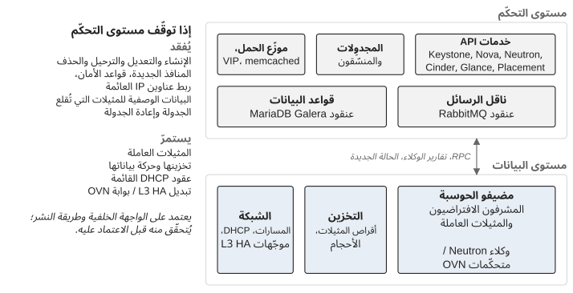

*الجزء الأول — فهم المشكلة*

# الفصل 1 — OpenStack لا ينتهي عند النشر

لمشروع النشر نهاية طبيعية. تصبح البنية التحتية جاهزة، وتُنشر خدمات OpenStack، ويكتمل التحقّق، ويُسلَّم التوثيق، وينتقل فريق المشروع إلى هدفه التالي. أمّا الإنتاج فلا يعرف هذه الحدود. فما إن تعتمد أحمال العمل على OpenStack حتى تدخل المؤسّسة مرحلة تصبح فيها المنصّة قدرة تشغيلية دائمة، ولهذه المرحلة لا تاريخ انتهاء. يسمّيها الممارسون اليوم الثاني (Day 2): كلّ ما يحدث بعد أن تُبنى المنصّة (اليوم الأول) وتصير تحمل أحمال عمل ذات أهمية. ويستخدم هذا الكتاب المصطلح بهذا المعنى في كلّ موضع.

يُستهان عادةً بالانتقال إلى اليوم الثاني، وهو يميل إلى الفشل على نحو يمكن التعرّف عليه. يبقى المهندسون الذين بنوا المنصّة مسؤولين عن الحوادث والتغييرات والدعم لأنّهم أعرف الناس بالهندسة المعمارية، فيصبحون نقطة التصعيد الافتراضية لكلّ شيء. وتعتقد المؤسّسة أنّها أنشأت نموذج تشغيل، بينما هي في الواقع قد مدّت فريق النشر إلى الإنتاج. الخبراء مكلفون ونادرون، ووقتهم مطلوب للهندسة المعمارية والترقيات والقرارات الهندسية الصعبة؛ لكنّه يُستهلك بدل ذلك في دعم متكرّر. وفي الأثناء لا تطوّر منظومة التشغيل الأوسع أيّ قدرة في OpenStack، لأنّ الخبراء يظلّون الوحيدين الموثوق بهم للتدخّل.

المخرج هو توزيع العمل التشغيلي بحسب المخاطر، لا إبعاد الخبراء عن التشغيل. فالإجراءات الروتينية، المفهومة جيّدًا، القابلة للتراجع، يمكن أن تنتقل تدريجيًا نحو الدعم من المستوى الأول، أي الفريق الذي يتلقّى بلاغات المستخدمين ويعالج المواقف المعروفة من إجراءات موثّقة؛ ويبقى التشخيص المعقّد وتغييرات المنصّة لدى الفريق المتخصّص. وينبغي أن يُرسم الحدّ بحسب التبعات والخبرة المطلوبة، لا بحسب ما يلائم التنظيم. وثمّة اختبار مفيد لأيّ عملية: هل تتطلّب خبرة في المنصّة أم إجراءً موثوقًا؟ فالتشخيص الذي يقتصر على القراءة ويمكن تنفيذه بأمان من إجراء موثّق لا ينبغي أن يحتاج إلى أكثر مهندسي OpenStack خبرة في الشركة، وكلّ عملية من هذا النوع تنتقل نحو الدعم من المستوى الأول تخلق سعة حيث تكون أشدّ ندرة.

## دورتا حياة، ومنصّة واحدة

للمنصّة دورتا حياة متشابكتان. تغطّي **دورة حياة التسليم** الميزات والترقيات والتكاملات والهندسة المعمارية والتحسينات. وتغطّي **دورة الحياة التشغيلية** الحوادث والصيانة وتطبيق التصحيحات والسعة والاستعادة والمراقبة والدعم. إنّهما بُعدان للمنصّة نفسها، وكلّ منهما يفشل من دون الآخر: فالفريق الذي يسلّم باستمرار من دون سعة تشغيلية ينتهي إلى خلق عدم الاستقرار، والفريق الذي يكتفي بحماية الحالة القائمة ينتهي إلى منصّة متقادمة لا يجرؤ أحد على لمسها. يتطلّب اليوم الثاني توازنًا صريحًا بينهما، توازنًا يُقرَّر بدل أن يُترك لمن يرفع صوته أكثر.

ينشأ التوتّر بين الدورتين عادةً من أهداف محلّية متعارضة. يريد التسليم إدخال قدرات جديدة؛ ويريد التشغيل، الذي تسمّيه مؤسّسات كثيرة RUN، الحفاظ على جودة الخدمة. وكلاهما مشروع، والمشكلة تبدأ حين يُعاملان كنظامين منفصلين. لا يمكن تقسيم منصّة OpenStack في الإنتاج إلى «الجزء الذي نغيّره» و«الجزء الذي نشغّله»: فالتغيير في Nova يصبح همًّا تشغيليًا، والمشكلة التشغيلية المتكرّرة تصبح همًّا معماريًا، والمتطلّب الأمني يصبح مشكلة سعة، والحادث يكشف عن قدرة ناقصة في المنتج. والجواب العملي هو إعطاء الطرفين رؤية مشتركة للتبعات. ينبغي أن يجيب أيّ تغيير مقترح عن أربعة أسئلة على الأقلّ: ما القدرة التي ينشئها أو يحميها، وما القدرة القائمة التي قد يؤثّر فيها، وما العبء التشغيلي الذي يضيفه، وما الذي سيلزم لتشغيله بعد أن ينتقل فريق التسليم إلى عمل آخر. وهذا مهمّ في OpenStack لأنّ حدود الخدمات ليست حدود الأعمال. فالتغيير الذي يبدو محصورًا في Nova قد يصل إلى Placement وNeutron وناقل الرسائل وقاعدة البيانات والمُشرفات الافتراضية (hypervisors) وسير عمل المستهلكين أنفسهم.

## اليوم الثاني منصّة في حركة

كثيرًا ما يُختزل اليوم الثاني في إبقاء الخدمات تعمل، وهذا التعريف أضيق من اللازم، لأنّ منصّة OpenStack لا تسكن أبدًا. تتغيّر أحمال العمل، وتتغيّر السعة، وتتقادم الإصدارات، وتتطوّر المتطلّبات الأمنية، ويُستبدل العتاد، وتُصحَّح التبعيات، ويطلب المستهلكون قدرات جديدة، وتتغيّر الفرق. على المنصّة أن تعمل *أثناء* تغيّرها، وهذه مشكلة مختلفة عن تشغيل نظام ساكن. التشغيل، بهذا المعنى، هو القدرة التي تتيح للتغيير أن يحدث من دون تدمير الحالة الموثوقة التي تعتمد عليها جهة الأعمال، ومن المفيد للجمع بين الفكرتين التمييز بين **حماية الحالة الراهنة** و**إنشاء الحالة التالية**. كلتاهما ضرورية، وهما تتنافسان على الأشخاص أنفسهم ونوافذ الصيانة نفسها والسعة نفسها.

ويغيّر الإنتاج أيضًا قواعد الهندسة. في المختبر، يستطيع المهندس أن يعيد بناء بيئة ليفهمها. أمّا في الإنتاج فتحتوي الحالة القائمة على أحمال عمل حرجة للأعمال وعلى تاريخ لا يمكن التخلّص منه ببساطة، ولذلك يجب أن يُحكم على التغيير لا بما إذا كان يعمل فحسب، بل بما إذا كان يمكن الاستعادة منه. وكلّ تغيير يستهلك موردًا محدودًا. نوافذ الصيانة محدودة. والمهندسون محدودون. وسعة الحوسبة اللازمة للترحيل الحيّ (live migration)، أي العملية التي تنقل مثيلًا يعمل من مُشرف افتراضي إلى آخر، محدودة. والانتباه المتاح للحوادث والترقيات والتوثيق محدود. يسمّي هذا الكتاب ذلك المورد **سعة التغيير**، ويعامله بوصفه قيدًا حقيقيًا لا إزعاجًا تخطيطيًا: فنوافذ الصيانة تتنافس مع الترقيات، والعمل الأمني يتنافس مع تسليم الميزات، وتمارين الاستعادة تتنافس مع الاستجابة للحوادث، ولا يستطيع المهندسون تنفيذ عدد غير محدود من التغييرات لمجرّد أنّ قائمة الأعمال المتراكمة تحتوي عليها. ويخلق هذا انضباطًا أعدّه من أثمن ما في عمل اليوم الثاني: أعطِ الأولوية للتغييرات التي تحسّن قدرة المنصّة على استيعاب التغييرات المقبلة. فالتبسيط الذي يزيل عبئًا تشغيليًا متكرّرًا قد يساوي أكثر من ميزة إضافية. وتمرين الاستعادة قد تكون قيمته على المدى الطويل أكبر من تحسين منخفض المخاطر. وتقليل الانحراف المحلّي عن المنبع (upstream) قد يجعل الترقية التالية أكثر أمانًا بشكل ملموس.

وفضلًا عن ذلك، لا علاقة تُذكر لكلفة التغيير بعدد الأوامر التي يتطلّبها. فقد تكون عملية صيانة روتينية من الناحية التقنية ومع ذلك تستهلك سعة تغيير حقيقية. وقد يتطلّب تصحيح أمني ترحيلات حيّة. وقد يؤثّر تعديل في الشبكات في عدّة خدمات دفعة واحدة. وقد تتطلّب ترقية تغييرات خارج OpenStack تمامًا. ما يحدّد الكلفة هو نطاق التأثير (أي أيّ جزء من المنصّة وكم من أحمال العمل سيطالهم فشل التغيير)، وعدم اليقين، وقابلية الاستعادة، والتبعيات، والأهمية الحرجة للأعمال، والسعة المتاحة في ذلك الوقت.

## التدهور المُتحكَّم فيه

يجب ألّا يُخلط الاستقرار بتجميد المنصّة. الحالات المعروفة هي أساس التغيير الآمن: فحين يفهم المهندسون كيف تبدو بيئة سليمة، تصبح الانحرافات قابلة للاكتشاف، وحين تكون إجراءات الاستعادة قد اختُبرت على حالة معروفة، تقلّ حاجة الاستجابة للحوادث إلى الارتجال. يسمّي هذا الكتاب مثل هذه الحالة **الحالة الموثوقة**: حالة يُعرف سلوكها وتبعياتها وخصائص استعادتها معرفة كافية للاعتماد عليها.

ويتفرّع التدهور المُتحكَّم فيه عن الفكرة نفسها، وتمنحه هندسة OpenStack المعمارية أساسًا متينًا على نحو غير معتاد. لنفترض أنّ مستوى التحكّم أصبح غير مستقرّ. تستطيع المؤسّسة أن تقرّر التوقّف عن قبول عمليات جديدة على الموارد مع حماية أحمال العمل التي تعمل بالفعل. وغالبًا ما يكون ذلك أفضل من ترك مستوى تحكّم غير مستقرّ يواصل قبول طلبات تجعل الاستعادة أصعب. لا تحتاج جهة الأعمال إلى أن تكون كلّ قدرة متاحة في كلّ لحظة؛ بل تحتاج إلى أن تبقى القدرات الأهمّ محميّة.

> **ملاحظة تقنية — مستوى التحكّم ومستوى البيانات يفشلان كلٌّ على حدة.** في OpenStack، يختلف مستوى التحكّم (خدمات API والمجدوِلات (schedulers) والمنسّقات (conductors) وناقل الرسائل وقواعد البيانات) عن مستوى البيانات (المُشرفات الافتراضية التي تشغّل الآلات الافتراضية، وأقراصها، ومساراتها الشبكية). إذا توقّفت خدمات API أو ناقل الرسائل أو قواعد البيانات أو تدهورت، تستمرّ المثيلات القائمة في العمل، وتحتفظ بتخزينها، وتواصل تبادل الحركة. ما يُفقد هو القدرة على إنشاء الموارد أو تعديلها أو ترحيلها أو حذفها، ونشر الحالة *الجديدة* إلى مستوى البيانات: فالمنفذ الجديد، أو قاعدة مجموعة الأمان المعدَّلة، أو عنوان IP العائم المرتبط حديثًا لن يسري مفعولها حتى يعود مستوى التحكّم، والمثيل الذي يُقلع أثناء الانقطاع قد يفشل في الوصول إلى خدمة البيانات الوصفية. أمّا الوظائف المنفَّذة على عقد مستوى البيانات نفسها فتبقى عمومًا: ففي الإعداد الشائع ML2/OVS، يواصل dnsmasq التابع لوكيل DHCP تقديم عقود DHCP القائمة ما دام مضيفه يعمل، ومع OVN يُجاب على DHCP محلّيًا في كلّ عقدة حوسبة؛ وتجاوز فشل الموجّهات (router failover) مع L3 HA (keepalived) أو مع gateway chassis في OVN آلية من آليات مستوى البيانات لا تحتاج إلى API. ويترتّب على ذلك تحذيران. تعمل وكلاء Neutron ومتحكّمات OVN *على* عقد مستوى البيانات، ولذلك قد تؤدّي إعادة تشغيل بعضها، بحسب الإصدار والإعداد، إلى انقطاع الحركة لفترة وجيزة؛ فينبغي أن يعني «إيقاف مستوى التحكّم» واجهات API والناقل وقواعد البيانات، لا الوكلاء. كما أنّ السلوك الدقيق يعتمد على الواجهة الخلفية للشبكات وعلى طريقة النشر، وينبغي التحقّق منه في كلّ منصّة قبل الاعتماد عليه أثناء حادث. انظر توثيق هندسة Nova المعمارية وتوثيق Neutron عن الوكلاء وOVN.

هذا الفصل بين المستويين (الشكل 1.1) هو ما يجعل «أوقفوا واجهات API واحموا أحمال العمل الجارية» خيارًا ذا مصداقية لا تلطيفًا لعبارة «انقطاع». ويبيّن الفصل 19 استخدامه في حادث.

قد تبدو آلتان افتراضيتان متطابقتين في نظر البنية التحتية بينما تختلف تبعاتهما على الأعمال اختلافًا تامًّا. ولذلك تحتاج المؤسّسة إلى طريقة لترجمة الحالة التقنية إلى أهمية حرجة للأعمال، وتحتاج إلى تلك الترجمة *قبل* الحادث. ويبيّن الفصل 20 ما يحدث حين تغيب أثناء حملة تطبيق تصحيحات.

*الشكل 1.1: مستوى التحكّم ومستوى البيانات يفشلان كلٌّ على حدة: ما يتوقّف وما يستمرّ حين تكون خدمات API وناقل الرسائل وقواعد البيانات غير متاحة.*

## للاستقرار كلفة من السعة

إذا استهلكت الحوادث والصيانة العاجلة كلّ السعة الهندسية، توقّفت المؤسّسة عن التوثيق والتدريب واختبار الاستعادة وتقليل الدين. وقد تبقى المنصّة عاملة بينما تصبح أقلّ استدامة شهرًا بعد شهر. الاستقرار قدرة تنظيمية بقدر ما هو خاصّية في البنية التحتية، والمنصّة التي تحتاج إلى بطولات فردية دائمة لتبقى مستقرّة ليست مستقرّة على الإطلاق.

ويجب أيضًا مقاومة إغراء إصلاح كلّ شيء. فليست كلّ مشكلة تستحقّ معالجة فورية. بعض الدين التقني معروف ومُتحكَّم فيه؛ وبعض العيوب منخفضة الأثر حملها أرخص من إزالتها؛ وبعض التحوّلات تخلق خطرًا أكبر من المشكلة التي كان يُفترض أن تحلّها. السؤال الذي يُطرح عن أيّ تحسين هو ما إذا كان إجراؤه *الآن* يقلّل من المخاطر أكثر ممّا يُدخل منها.

## التسليم انتقال في القدرة

ينبغي أن يُعامل الانتقال من النشر إلى التشغيل بوصفه نقلًا للقدرة، لا معلمًا من معالم المشروع. قد يعرف فريق النشر لماذا اختيرت طوبولوجيا معيّنة لـRabbitMQ، ولماذا يُراقب سلوك قاعدة البيانات بطريقة معيّنة، ولماذا قُيّدت بعض إعدادات Nova عمدًا، ولماذا تُعدّ تبعية شبكية ما حرجة. ولا يُنقل شيء من تلك المعرفة لمجرّد وجود كتيّب إجراءات (runbook). والسؤال الأصعب الذي يجب أن يجيب عنه التسليم هو ما إذا كانت المؤسّسة المتسلّمة قادرة على اتّخاذ قرار آمن من دون حضور فريق النشر.

ويشمل ذلك القرارات الروتينية كما يشمل الحوادث. ينبغي أن يعرف فريق التشغيل أيّ الأعراض يمكن معالجتها محلّيًا، وأيّها يتطلّب التصعيد، وما الأدلّة التي يجب جمعها قبل التصعيد، وأيّ الإجراءات محظورة صراحةً. وينبغي أن يبقى مهندسو المنصّة متاحين للمشكلات الصعبة، لكن بوصفهم قدرة تصعيد، لا نموذج التشغيل نفسه. وعلى نطاق واسع يصبح الأمر حتميًا: فالمنصّة التي تخدم مئات أحمال العمل أو آلافها لا يمكن تشغيلها بمعاملة كلّ حدث كاستشارة خبير. إنّها تحتاج إلى نموذج متدرّج تُرشَّح فيه الإشارات الروتينية، وتُوحَّد الإجراءات الشائعة، وتُحفظ الخبرة النادرة للمواقف التي تضيف فيها قيمة غير متناسبة.

لا يلزم أن يكون نموذج التشغيل الأول كاملًا، لكن يلزم أن يوجد قبل أوّل يوم في الإنتاج. ينبغي أن تعرف المؤسّسة أيّ فريق يتلقّى بلاغ المستخدم، وأيّ فريق يستطيع فحص المنصّة، وأيّ الإجراءات روتينية، وأيّها يتطلّب تدخّل متخصّص، ومن يستطيع أن يأذن باستعادة مُعطِّلة. وهذا مهمّ في OpenStack لأنّ الملكية الظاهرة مضلّلة: فقد يملك فريق المنصّة Nova بينما يملك فريق آخر المُشرفات الافتراضية، وفريق ثالث نسيج الشبكة (fabric)، وفريق رابع البنية التحتية لقواعد البيانات. والحادث لا يحترم تلك الحدود، ولذلك يحتاج نموذج التشغيل إلى مسار صريح يعبرها. وتكشف بروفة بسيطة ما إذا كان ذلك المسار موجودًا. مستخدم لا يستطيع إنشاء آلة افتراضية. من يتلقّى الطلب؟ ما الأدلّة التي تُجمع؟ أيّ الخدمات تُفحص؟ من يحقّق في Placement أو Neutron؟ من يقرّر ما إذا كان ينبغي تقييد واجهة API؟ من يتحدّث إلى المستهلك؟ إذا كانت هذه الأسئلة تنتج أجوبة مختلفة بحسب من يصادف أن يكون متاحًا، فالمنصّة ليست جاهزة تشغيليًا، مهما قالت اختبارات القبول.

وعبارة «كلّ شيء أخضر» ليست بدورها تعريفًا مفيدًا لمنصّة OpenStack سليمة. فقد يجتاز النشر اختبارات القبول بينما تظلّ المؤسّسة غير مستعدّة للإنتاج: قد تبدأ خدمة بشكل صحيح من دون أن يعرف أحد كيف تتصرّف تحت الحمل، وقد ينجح ترحيل من دون أن تكون هناك سعة لحدث صيانة كامل، وقد تعمل ميزة من دون إجراء استعادة موثّق. ينبغي أن تعرف المؤسّسة ما يعنيه التشغيل الموثوق لقدراتها الحرجة، مثل تزويد الآلات الافتراضية، واتّصال المستأجرين (tenants)، وعمليات وحدات التخزين، والمصادقة، وترحيل أحمال العمل، والاستعادة. ومن دون تلك التعريفات يكون الاستقرار مجموعة من فحوص الصحّة لا حالة ذات معنى للأعمال. ولهذا أيضًا ينبغي إشراك المشغّلين المستقبليين قبل نهاية اليوم الأول: فهم يحتاجون إلى رؤية للتصميم، لا إلى حزمة تسليم فحسب، ويحتاجون إلى معرفة أيّ افتراضات المصمّمين مهمّ بما يكفي ليصبح قيدًا تشغيليًا.

## يجب ألّا يصبح فريق النشر تبعية دائمة

أقوى فرق النشر تخلق خطرها التشغيلي الخاصّ لأنّها جيّدة تحديدًا. فهي تعرف الهندسة المعمارية أفضل من أيّ أحد، وتحلّ الحوادث بسرعة، وتتذكّر الأسباب وراء القرارات غير المعتادة، فتصبح المؤسّسة متردّدة في نقل المسؤولية عنها. وهذا مفهوم وخطير في آن. ينبغي أن تكون غاية الخبرة جعل المؤسّسة أقلّ اعتمادًا على تلك الخبرة في التشغيل الروتيني، مع بقاء الخبراء متاحين للقرارات عالية التبعات والمشكلات الهندسية الصعبة.

> **مبدأ.** مقياس نجاح النشر هو ما إذا كانت المنصّة تبقى قابلة للتشغيل حين لا يعود خبراء النشر حاضرين.

النشر هو حيث تبدأ مسؤولية المؤسّسة طويلة الأمد عن المنصّة، والهدف التشغيلي الأول هو بناء مؤسّسة قادرة على تشغيل ما بُني بالفعل.

---

[المقدّمة →](00-introduction.md) · [المحتويات](../README.md) · [← الفصل 2 — العدوّ هو فقدان التحكّم](02-the-enemy-is-loss-of-control.md)

