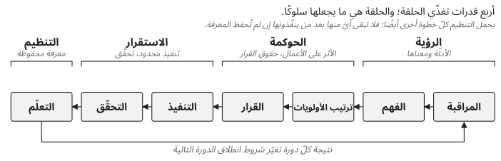

*الجزء الأول — فهم المشكلة*

# الفصل 4 — حلقة التحكّم

تتحوّل القدرات الأربع إلى سلوك تشغيلي عبر حلقة تربط بين أنشطة تمارسها معظم المؤسّسات أصلًا:

**المراقبة** ← **الفهم** ← **ترتيب الأولويات** ← **القرار** ← **التنفيذ** ← **التحقّق** ← **التعلّم**

سيتعرّف القرّاء الذين يعرفون دورة «خطّط – نفّذ – تحقّق – صحّح» أو حلقة «راقب – توجّه – قرّر – نفّذ» على هذا الشكل؛ فالحلقة لا تدّعي أيّ جدّة. قيمتها في هذا الكتاب أنّها تسمّي الخطوة التي تُتجاوَز غالبًا على منصّة تحت الضغط، وأنّها تبيّن أين تؤدّي كلّ قدرة من القدرات الأربع عملها (الشكل 4.1).

*الشكل 4.1: القدرات الأربع وخطوات حلقة التحكّم التي تغذّيها.*

يُنتج OpenStack إشارات كثيرة، وقد يشمل فشل إنشاء آلة افتراضية واحدة عدّة خدمات وتبعيات في آن واحد. توفّر الرؤية الأدلّة، لكنّ الأدلّة ليست فهمًا. يحدّد الفهم الفرضيات والقيود ذات المعنى. ويُدخل ترتيب الأولويات الأثر على الأعمال. وتحدّد حقوق القرار، أي الصلاحية الصريحة لاتخاذ قرار وقبول تبعاته، من يختار بين الخيارات. ويجب أن يبقى التنفيذ ضمن حدود مفهومة. ويحدّد التحقّق ما إذا كانت النتيجة المقصودة قد تحقّقت، لأنّ النجاح التقني ليس نجاح الخدمة: فالترحيل الحيّ الناجح لا يثبت أنّ مشكلة الأداء التي كان يُفترض أن يحلّها قد زالت. ويحوّل التعلّم النتيجة إلى قدرة تنظيمية.

## تعمل الحلقة على عدّة مقاييس زمنية

تستخدمها العمليات باستمرار. وتستخدمها إدارة التغيير أثناء الانتقالات المُتحكَّم فيها. ويستخدمها التطوير على امتداد فترات من دورة الحياة تُقاس بالسنوات. قد يكتشف مهندس تشغيل مشكلة متكرّرة اليوم؛ فيعالجها فريق المنصّة في دورة الصيانة التالية؛ ثمّ تزيل الهندسة المعمارية التبعية الكامنة وراءها في الترقية التالية. هذه مقاييس زمنية مختلفة للحلقة نفسها، وقيمة الإطار تأتي من ربطها ببعضها. والحلقة أيضًا نظام تغذية راجعة: فاستعادة فاشلة تحسّن التوثيق، وحادث متكرّر يغيّر قابلية الملاحظة، وترقية عسيرة تحفّز على التبسيط، وتغيير في الفريق يكشف اعتمادًا على معرفة ما. ومن دون تلك التغذية الراجعة تظلّ المؤسّسة تحلّ الأعراض مرّة بعد مرّة.

## أين تنكسر الحلقة

عندما يضعف التحكّم، تكون الخطوة المنكسرة ظاهرة في الغالب: مراقبة بلا فهم، أو فهم بلا قرار، أو قرار بلا سعة للتنفيذ، أو تنفيذ بلا تحقّق، أو تعلّم بلا احتفاظ. والأخيرة هي أهدأ أشكال الفشل. فالتعلّم الذي يبقى لدى الأشخاص المعنيين يختفي حين يغادرون، ولذلك يجب أن تنتهي الحلقة بشيء محفوظ: توثيق، أو ملكية، أو تدريب، أو قياس، أو تغيير في المنصّة. هذا ما يجعلها تنظيمية لا إجرائية.

## الحلقة مخصّصة للمواقف الملتبسة

ينتقل الطلب الروتيني من المراقبة إلى التنفيذ في دقائق ولا يحتاج إلى أيّ مراسم. وتكتسب الحلقة مكانتها حين لا يكون الجواب بديهيًا. تشير إشارة أولى إلى مشكلة في Nova؛ ويكشف التحقيق عن شذوذ في المراسلة؛ وتبيّن أدلّة أخرى أنّ قاعدة البيانات متأثّرة أيضًا؛ ويتغيّر الأثر على الأعمال لأنّ أحمال العمل القائمة تبقى متاحة بينما يتوقّف التزويد الجديد. لم يعد القرار «أصلحوا Nova». بل أصبح «احموا الحالة الموثوقة للمنصّة مع قبول فقدان مؤقّت لقدرة التزويد»، والحلقة هي ما يتيح للمؤسّسة أن تغيّر قرارها مع تغيّر الأدلّة. يتتبّع الفصل 19 تسلسلًا شبيهًا جدًّا بهذا عبر حادث حقيقي.

لذلك يجب أن تعمل الحلقة بسرعة البشر. يغدو الإطار بلا فائدة إن اقتضى اجتماعًا لكلّ قرار. ينبغي أن يكون خفيفًا للعمل الروتيني وأن يزداد صراحةً كلّما كبرت التبعات وعدم اليقين؛ وهذا التناسب هو ما يفصل التحكّم عن البيروقراطية. والتعلّم بدوره يجب أن يغيّر شيئًا: فمراجعة الحادث التي لا تُنتج سوى تقرير قيمتها ضئيلة. وإذا لم يتغيّر شيء بعد حادث ما، فينبغي أن تكون المؤسّسة قادرة على تفسير لماذا كانت الضوابط القائمة كافية أصلًا.

ويتطلّب التحكّم أيضًا سعة: فعندما تستهلك الحوادث والصيانة كلّ وقت الهندسة المتاح، تفقد الحلقة خطوتيها الأخيرتين بهدوء. المؤسّسة الناضجة في OpenStack لم تقضِ على السلوك غير المتوقّع. إنّها مؤسّسة يستطيع فيها المهندسون التحقيق من دون تخمين، وللقرارات فيها مالكون واضحون، وتُنفَّذ فيها التغييرات ضمن حدود مفهومة، وتبقى فيها المعرفة التشغيلية بعد رحيل الأفراد الذين اكتسبوها.

---

[الفصل 3 — لماذا تصبح المنصّات الجيّدة صعبة التشغيل →](03-why-good-platforms-become-difficult-to-operate.md) · [المحتويات](../README.md) · [← الفصل 5 — تقييم التحكّم في المنصّة](05-assessing-platform-control.md)

