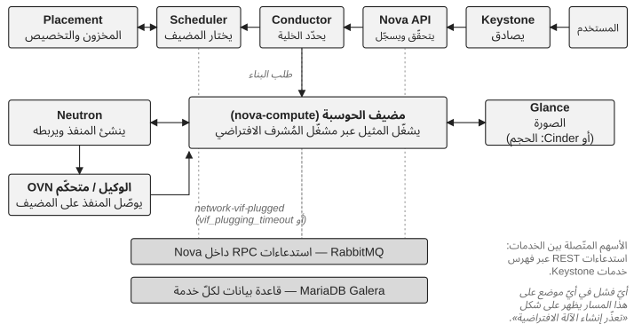

*الجزء الثاني — تقييم التحكّم*

# الفصل 5 — تقييم التحكّم في المنصّة

قبل تغيير بيئة OpenStack صعبة، تحتاج المؤسّسة إلى معرفة أين تقف. وينبغي أن يبدأ التقييم بما تعتمد عليه جهة الأعمال، لا بقائمة المكوّنات. وثمّة سلسلة مفيدة تتتبّع عاقبة الفشل عبر المنصّة:

**قدرة أعمال** ← **قدرة OpenStack** ← **خدمة المنصّة** ← **تبعية تقنية** ← **الفريق** ← **الخبرة** ← **قدرة الاستعادة**

تعتمد قدرة أعمال ما، لنقل، على تزويد الآلات الافتراضية. وتشمل تلك القدرة Nova وPlacement، لكن أيضًا Keystone وGlance وNeutron وناقل الرسائل وقواعد البيانات والتخزين والبنية التحتية الكامنة. ثمّ يلزم تحديد من يملك كلّ تبعية، ومن يستطيع تشخيصها، ومن يستطيع استعادتها. والأثر على الأعمال يأتي أوّلًا: فقد يحتاج مكوّن بالغ التعقيد يدعم قدرة غير حرجة إلى اهتمام فوري أقلّ ممّا تحتاجه تبعية بسيطة تدعم حِمل عمل حرجًا.

> **ملاحظة تقنية — ما الذي يجتازه إنشاء آلة افتراضية فعلًا.** يصادق Keystone على طلب إنشاء خادم، ثمّ تتلقّاه واجهة Nova API فتتحقّق منه، وتسجّل الطلب في قاعدة بيانات الواجهة، وتسلّم البناء إلى المنسّق (conductor)، وهو خدمة Nova التي تنسّق العمليات متعدّدة الخطوات وتتوسّط وصول عقد الحوسبة إلى قاعدة البيانات. ويختار المجدوِل (scheduler) مضيفًا، مستعينًا بـPlacement للعثور على resource providers يملكون المخزون المطلوب ولحجز التخصيص. ولكلّ نشر خلية واحدة على الأقلّ (Nova cells v2)، ويربط المنسّق المثيل بالخلية التي ستحتفظ قاعدة بياناتها به؛ والمضيف الموجود الذي لم يُربط بخلية عبر `nova-manage cell_v2 discover_hosts` يُفشل عمليات البناء برسالة «host is not mapped to any cell»، وهو سبب كلاسيكي لحالة «السعة موجودة لكن لا شيء يحطّ عليها». تسترجع خدمة الحوسبة المختارة الصورة من Glance (أو تطلب الحجم من Cinder في حالة الإقلاع من حجم)، وتطلب من Neutron إنشاء المنفذ وربطه، وتوعز إلى مشغّل المُشرف الافتراضي (hypervisor) ببدء المثيل. وربط المنفذ (port binding) هو الخطوة التي يقوم فيها mechanism driver الخاصّ بـNeutron والوكيل أو متحكّم OVN على عقدة الحوسبة بتوصيل المنفذ؛ ثمّ تنتظر Nova حدث `network-vif-plugged` من Neutron قبل إتمام الإقلاع، والمثيل الذي يبقى في الحالة BUILD حتى انقضاء `vif_plugging_timeout` هو عادةً مشكلة شبكات تتنكّر في عرَض حوسبة. داخل Nova، تتخاطب الواجهة والمنسّق والمجدوِل وخدمة الحوسبة عبر ناقل oslo.messaging، وهو RabbitMQ في العادة؛ أمّا الاستدعاءات إلى Keystone وPlacement وGlance وNeutron وCinder فهي استدعاءات REST عبر فهرس الخدمات، ومع واجهة خلفية للشبكات قائمة على الوكلاء يتخاطب neutron-server مع وكلائه عبر الناقل نفسه (بينما يستخدم OVN قواعد بياناته الخاصّة بدلًا من ذلك). وتقرأ كلّ خدمة قاعدة بياناتها وتكتب فيها. لذلك قد ينشأ فشل ظاهر للمستخدم في إنشاء آلة افتراضية في أيّ من هذه الخدمات، أو في ناقل الرسائل، أو في عنقود قواعد البيانات، أو في بنية الشبكة والتخزين التحتية الكامنة تحتها. انظر توثيق معمارية Nova وتوثيق cells v2.

*الشكل 5.1: ما يجتازه إنشاء آلة افتراضية: الخدمات المعنية، والاستدعاءات بينها، والمكوّنات المشتركة تحتها.*

## قيّم عبر القدرات لا عبر المكوّنات

جرد المكوّنات مفيد لكنّه غير كافٍ. فإدراج Nova وNeutron وCinder وGlance وKeystone وPlacement وRabbitMQ وMariaDB وتبعيات البنية التحتية يقول ما هو موجود؛ لكنّه لا يقول هل تستطيع المؤسّسة تشغيل الخدمة الناتجة. لذلك ينبغي أن يتتبّع التقييم القدرات. في الحوسبة، اسأل هل يمكن جدولة أحمال العمل وإنشاؤها وترحيلها وتغيير حجمها واستعادتها. وفي الشبكات، اسأل هل يمكن فهم اتصال المستأجرين والتوجيه ومجموعات الأمان والوصول الخارجي واستعادتها. وفي التخزين، اسأل هل يمكن تشغيل الأحجام وواجهاتها الخلفية واستعادتها. وفي الهوية، اسأل هل يمكن تشخيص أعطال المصادقة والتفويض من دون جعل الوضع أسوأ. وهكذا تصبح نظرة المكوّنات أدلّة لتقييم القدرات لا التقييم نفسه.

أنجع طريقة أعرفها لذلك هي تتبّع رحلة مستخدم حقيقية: خذ قدرة ممثّلة، مثل إنشاء آلة افتراضية، وسِر بالمعاملة عبر كلّ تبعية في الشكل 5.1، واسأل عند كلّ خطوة أين الإشارة، ومن يملك التبعية، وكيف يُكتشف الفشل ويُستعاد، وأيّ قدرة أعمال تتأثّر. يكشف هذا التمرين بانتظام فجوات تفوّتها المراجعة مكوّنًا مكوّنًا، وأكثر ما يكون ذلك عند الحدود بين الفرق.

## طيف التحكّم

يمكن للتقييم بعد ذلك أن يضع كلّ قدرة على طيف. والمستويات أسئلة عن الأدلّة، والمعايير أدناه هي ما أستخدمه حتى يصل مهندسان يقيّمان القدرة نفسها إلى الجواب نفسه.

**مجهول** ← **مرئي** ← **مفهوم** ← **مُتحكَّم فيه** ← **قابل للاستعادة** ← **مستدام**

- **مجهول.** لا أحد يستطيع أن يقول بثقة أيّ الخدمات والتبعيات تشملها القدرة، أو من يملكها.
- **مرئي.** التبعيات مرسومة والإشارات الرئيسية موجودة، لكنّ معناها غير مُثبت: ينطلق تنبيه من دون أن يعرف أحد هل له أهمية.
- **مفهوم.** تستطيع المؤسّسة أن تشرح السلوك الطبيعي والسلوك المتدهور، ويستطيع شخصان على الأقلّ تشخيص فشل القدرة.
- **مُتحكَّم فيه.** تتبع التغييرات على القدرة مسارًا معروفًا بشروط توقّف وتحقّق؛ والملكية وحقوق القرار صريحة.
- **قابل للاستعادة.** أُثبتت الاستعادة عمليًا، على يد شخص غير كاتب الإجراء، في زمن تراه جهة الأعمال مقبولًا.
- **مستدام.** أُثبتت الاستعادة والتغيير عمليًا أكثر من مرّة، على مرّ الوقت وبعد تغيّرات في الفريق، وتبقى المعرفة من دون شخص بعينه.

ينبغي أن تعني عبارة «يمكن استعادة RabbitMQ» أنّ إجراء الاستعادة موثَّق ومفهوم وقد أُثبت عمليًا. وينبغي أن تعني عبارة «لدينا تراجع» أنّ للتراجع مسارًا موثوقًا وحالة سليمة معروفة يعود إليها. وينبغي أن يكشف التقييم حقائق غير مريحة: أين الملكية غامضة، وأين تعتمد الاستعادة على شخص واحد، وأيّ التبعيات الحرجة ضعيفة الملاحظة، وأيّ التغييرات لا يمكن عكسها بأمان، وأيّ أجزاء المنصّة انحرفت عن المنبع (upstream)، وأيّ الفرق مثقلة. والقرّاء الذين يعرفون *scaling journey* الخاصّة بـLarge Scale SIG (الإعداد، والمراقبة، والتوسّع الرأسي، والتوسّع الأفقي، والترقية والصيانة) سيلاحظون أنّها تسير على محور مختلف: فهي تصف ما يجب على نشر متنامٍ أن يتقنه تاليًا، بينما يصف هذا الطيف كم تتحكّم المؤسّسة فعلًا فيما تشغّله أصلًا. والاثنان متكاملان.

## الثقة يجب أن تُختبر وتُجعل صريحة

تبالغ المؤسّسات في تقدير التحكّم بانتظام لأنّ الأنظمة المألوفة تبدو مفهومة. فالمهندس الذي استعاد خدمة مرّات كثيرة يشعر بالثقة، وتلك الثقة مفيدة، لكنّها ليست دليلًا على أنّ مهندسًا آخر يستطيع فعل الشيء نفسه تحت الضغط. وينبغي أن يختبر التقييم الافتراضات عمدًا: اطلب من شخص لم يصمّم المنصّة أن يشرح تبعية حرجة؛ واطلب من مهندس أن يسرد خطوات استعادة من دون تنفيذها؛ واسأل مالكًا ماذا سيحدث لو كان الخبير الأساسي غير متاح الأسبوع المقبل. تكشف هذه التمارين فجوات في التحكّم لا تظهرها مخطّطات المعمارية أبدًا.

وينبغي أن تحمل الأدلّة أيضًا مستوى ثقة. فما لوحظ في الإنتاج أقوى ممّا هو موثَّق لكن لم يُمارس قطّ. وما أُثبت عمليًا في بيئة مُتحكَّم فيها أقوى من إجراء غير مختبَر. والمعرفة التي أُعيد إنتاجها باستقلال أقوى من تصريح خبير وحيد. والمقياس الدقيق أقلّ أهمية من جعل الثقة مرئية، حتى لا يعامل التقييم الافتراضات بصمت على أنّها حقائق.

## ينبغي أن يُنتج التقييم قرارات

التقييم الذي لا يُخرج سوى درجة نضج قيمته ضئيلة. فينبغي أن تؤدّي كلّ نتيجة مهمّة إلى واحدة من أربع مخرجات: التصرّف الآن، أو التخطيط، أو المتابعة، أو القبول الواعي. يعيد ذلك التقييم قسرًا إلى الحوكمة ويمنعه من أن يصبح تمرين توثيق آخر. وينبغي أن يبقى المُخرَج عمليًا: حالة التحكّم الراهنة، والمخاطر الحرجة، وفجوات التحكّم، والإجراءات الفورية، والمشكلات البنيوية، وخارطة طريق للتحكّم (يقدّم الملحق ب ورقة عمل).

ولا ينبغي أن يصبح التقييم تدقيقًا دائمًا. فغرضه إرساء خطّ أساس موثوق يمكن اتّخاذ القرارات انطلاقًا منه. وما إن تُفهم الفجوات الكبرى حتى ينبغي للمؤسّسة أن تتّجه إلى الفعل والقياس؛ وإلّا صار التقييم شكلًا من مسرح التحكّم، أي آلية تخلق مظهر التحكّم من دون أن تحسّن شيئًا.

> **مبدأ.** يخبرنا التقييم أين نحن. ويخبرنا القياس هل نتحرّك في الاتجاه الصحيح. التقييم ليس تحوّلًا؛ غرضه أن يجعل التحوّل أكثر أمانًا.

---

[الفصل 4 — حلقة التحكّم →](04-the-control-loop.md) · [المحتويات](../README.md) · [← الفصل 6 — قياس التحكّم](06-measuring-control.md)

