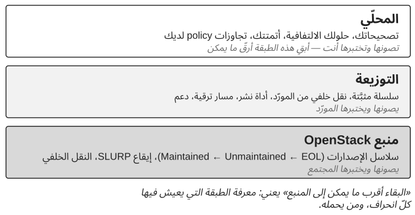

*الجزء الخامس — التطوّر دون فقدان التحكّم*

# الفصل 14 — الترقيات والنقل الخلفي والمواءمة مع المنبع

لا يمكن لمنصّة OpenStack أن تبقى على حالها إلى ما لا نهاية. فالإصدارات تشيخ، ومتطلّبات الأمن تتطوّر، والتبعيات تتوقّف عن الصيانة، والتعديلات المحلّية تتراكم، وكلفة الوقوف في المكان تصبح في النهاية جزءًا من الخطر. والترقية تغيّر أكثر من البرمجيات: إنّها تغيّر افتراضات التشغيل، والتبعيات، والإجراءات، وطرائق الاستعادة، والمراقبة، وأحيانًا المهارات التي يحتاج إليها الفريق.

المنصّة التي تبقى قريبة بقدر معقول من منبع (upstream) OpenStack تستفيد من إصلاحات المجتمع، ومن الإصدارات المصونة، ومن رصيد من المعرفة التشغيلية المشتركة مع المشغّلين الآخرين. ويقلّل اتّباع المنبع أيضًا مقدار *التأويل* الذي على المؤسّسة أن تقوم به: فحين يحقّق المهندسون في سلوك قريب من المنبع، يمكنهم الاعتماد على توثيق المجتمع، والعيوب المعروفة، وملاحظات الإصدار، وتجربة الآخرين، وكلّ انحراف محلّي ينتزع شيئًا من تلك المعرفة المشتركة.

> **مبدأ.** ابقَ أقرب ما يمكن عمليًا إلى المنبع.

## مفردات: مصون، مدعوم، منقول خلفيًا

كلمتان في هذا النقاش يستعملهما المشغّلون باستخفاف، ويجدر أن نكون دقيقين بشأنهما مرّة واحدة. ويُعرَّف مصطلح ثالث، SLURP، في الملاحظة نفسها لأنّ سياسة الصيانة تتوقّف عليه.

> **ملاحظة تقنية — ما الذي يصونه المنبع، وماذا يعني «النقل الخلفي».** منبع OpenStack لا «يدعم» الإصدارات؛ بل *يصون* فروعًا. منذ سلسلة 2023.1، يُسمّى كلّ إصدار ثانٍ إصدار SLURP (Skip Level Upgrade Release Process، أي عملية إصدار تتيح الترقية بتخطّي مستوى): الترقيات مدعومة بين إصدارَي SLURP متتاليين كما بين الإصدارين المتجاورين، فيمكن للنشر أن يختار الترقية مرّة في السنة بدل كلّ ستّة أشهر. تكون سلسلة الإصدارات **Maintained** (مصونة) نحو ثمانية عشر شهرًا، تُقبل خلالها إصلاحات العيوب المناسبة وتُنتَج إصدارات نقطية. وبموجب السياسة السارية وقت كتابة هذا الكتاب، قد تصبح سلسلة SLURP بعد ذلك **Unmaintained** (غير مصونة)، حيث يظلّ بالإمكان دمج الإصلاحات مع تكامل مستمرّ (CI) مخفَّض ومن دون إصدارات ما دام اهتمام المجتمع قائمًا، في حين تنتقل السلاسل غير SLURP مباشرة إلى **End of Life** (نهاية العمر)، حين لا يقبل الفرع أيّ تغييرات أخرى. وعندما تنتقل سلسلة إلى Unmaintained، يُستبدل بفرعها `stable/<series>` فرع `unmaintained/<series>`، ممّا يعطّل أيّ أدوات تثبّت الاسم القديم؛ وعند End of Life يُحذف الفرع ولا يبقى سوى وسم (tag). وقد تغيّرت هذه السياسة أكثر من مرّة في السنوات الأخيرة، وينبغي التحقّق منها على releases.openstack.org قبل الاعتماد عليها. أمّا الدعم التجاري، بجداوله الزمنية الخاصّة وتصحيحاته الخاصّة، فيأتي من التوزيعات والمورّدين لا من المنبع. وفي مفردات المنبع، **النقل الخلفي** (backport) هو *cherry-pick* لإصلاح دُمج أصلًا في الفرع الرئيسي (master) إلى فرع مستقرّ أقدم، بموجب سياسة الفروع المستقرّة: خطر تراجع منخفض، وفائدة ظاهرة للمستخدم، ولا ميزات جديدة، ولا تغييرات في واجهة البرمجة أو في مخطّط قاعدة البيانات. وفي هذا الكتاب، ما لم يُذكر خلاف ذلك، يعني *النقل الخلفي* شيئًا أوسع وأكثر محلّية: تغييرًا تحمله المنصّة المنشورة وليس جزءًا من الإصدار الذي تشغّله، سواء أكان مستمدًّا من نقل خلفي في فرع مستقرّ في المنبع، أم من إصدار لاحق، أم من إصلاح محلّي بحت. والتمييز مهمّ لأنّ النقل الخلفي في المنبع يختبره المجتمع ويصونه، في حين أنّ النقل الخلفي المحلّي تختبره وتصونه أنت. انظر سياسة الفروع المستقرّة في OpenStack وحالة سلاسل الإصدارات على releases.openstack.org.

## النقل الخلفي قرار مخاطر

البقاء قريبًا من المنبع ليس تحريمًا للتعديلات المحلّية. فقد يكون النقل الخلفي معقولًا حين يجب معالجة عيب، وحين تخلق الترقية الكاملة خطرًا إنتاجيًا فوريًا أكبر: إصدار إنتاجي مستقرّ يحتوي عيبًا معروفًا، والإصلاح موجود في إصدار أحدث، وأثر العيب محدود، والترقية تحمل خطرًا كبيرًا هذا الربع. والحالة الأكثر مشروعية هي تنبيه أمني (الفصل 17) يوجد إصلاحه في المنبع لكن ليس للسلسلة التي تشغّلها المنصّة. في ذلك الموقف قد يكون النقل الخلفي المُتحكَّم فيه هو القرار الصائب. لكنّه قرار مخاطر، وينبغي أن يُفهم على أنّه انحراف محلّي له مالك، وأصل، واختبار، وشرط خروج. وفي الحدّ الأدنى ينبغي أن تعرف المؤسّسة أيّ مشكلة في المنبع يعالجها، ومن أيّ تغيير في المنبع يُستمدّ، ولماذا لم تُختر الترقية الكاملة، ومن يملك التعديل المحلّي، وكيف يُختبر، ومتى ينبغي إعادة النظر فيه. النقل الخلفي الذي لا شرط خروج له هو قرار توقّفت المؤسّسة عن اتّخاذه.

ويصبح القرار خطيرًا حين تتحوّل عمليات النقل الخلفي إلى استراتيجية دورة الحياة. فكلّ تعديل محلّي يضيف كلفة اختبار واستكشاف أعطال وتوفيق، ومع الوقت يصبح الانحراف دين تحكّم. والسؤال الذي يُطرح على كلّ نقل خلفي هو: ما التحكّم الذي تكسبه المؤسّسة الآن، وما دين التحكّم الذي تقبله لاحقًا. وأفضل وقت لإزالة نقل خلفي هو عادةً ترقية مخطّطة: فقد يجعله الإصدار المصون التالي غير ضروري، ومعاملة أحداث دورة الحياة بوصفها فرصًا لإزالة الانحرافات المحلّية تمنع القرارات قصيرة الأجل من أن تصبح انحرافًا دائمًا.

## عندما تقف توزيعة بينك وبين المنبع

معظم المنصّات الحرجة لا تشغّل منبع OpenStack مباشرة. بل تشغّل توزيعة تجارية، لها أداة نشر، وعقد دعم، ودورة حياة خاصّة بها، وعبارة «ابقَ أقرب ما يمكن عمليًا إلى المنبع» تحتاج إلى ترجمة لذلك القارئ. فالتوزيعة هي نفسها انحراف محمول: إنّها تثبّت سلسلة الإصدارات، وتطبّق عمليات النقل الخلفي الخاصّة بها، وقد يختلف مسار الترقية المدعوم لديها عن حساب SLURP في المنبع، فيكون أطول أحيانًا، ومقيّدًا أحيانًا بتسلسل المورّد نفسه. لا شيء من هذا يناقض المبدأ. فعمليات النقل الخلفي لدى المورّد يختبرها المورّد ويصونها، وهذا أفضل بكثير من أن تقوم بذلك وحدك؛ وجدول دعم المورّد، لا جدول المنبع، هو الذي يحكم متى يجب أن تتحرّك المنصّة؛ والتعديلات المحلّية التي تخلق دين تحكّم هي تلك التي تُبنى فوق التوزيعة، لا التوزيعة نفسها. ما يطلبه المبدأ من المؤسّسة هو أن تعرف أين تقع منصّتها في طبقات ثلاث، المنبع والتوزيعة والمحلّي (الشكل 14.1)، وأن تُبقي الطبقة الثالثة رقيقة ما استطاعت.

ويستحقّ عقد الدعم التدقيق نفسه الذي تستحقّه أيّ تبعية أخرى. قال الفصل 2 إنّ العلاقة الخارجية الصحّية تزيد القدرة الداخلية مع الوقت؛ وينبغي أن تُحكَّم العلاقة مع المورّد بذلك الاختبار. ينبغي أن تكون المؤسّسة قادرة على أن تقول أيّ العمليات تستطيع تنفيذها من دون فتح تذكرة، وأيّها لا تستطيع، وهل القائمة الثانية تتقلّص. وينبغي أن تتوقّع من كلّ تصعيد لا إصلاحًا فحسب بل تفسيرًا يمكن للفريق إعادة استعماله، ومن كلّ تعامل نقلًا للمعرفة التشغيلية المعنية. المورّد الذي يكون الطرف الوحيد القادر على تفسير سلوك المنصّة هو فجوة التحكّم من الفصل 2 وعليها شعار.

## ينبغي أن تكون استراتيجية الترقية مستمرّة

تعامل المؤسّسات أحيانًا الترقيات على أنّها مشاريع استثنائية تفصل بينها فترات طويلة من الركود؛ ويبيّن استطلاع مستخدمي OpenStack الذي تنشره المؤسّسة الراعية، سنة بعد سنة، أنّ عمليات النشر الإنتاجية موزّعة على سلاسل كثيرة، منها ما لم يعد المنبع يصونه، ولذلك فإنّ المنصّة في مثال الفصل 18 ليست حالة غير مألوفة. والنهج الأصحّ هو الحفاظ في كلّ وقت على اتّجاه موثوق نحو الحالة التالية. ولا يتطلّب ذلك الترقية باستمرار. بل يعني فهم دورة حياة الصيانة، والانحراف المحلّي للمنصّة، وقدرتها على الاستعادة، وجاهزية المؤسّسة، في وقت مبكّر بما يكفي لتكون الترقية التالية انتقالًا مخطّطًا لا حالة طوارئ.

*الشكل 14.1: الطبقات الثلاث بين المنصّة العاملة ومنبع OpenStack، ومن يصون كلًّا منها.*

> **ملاحظة تقنية — ما يعد به SLURP وما لا يعد به.** الترقيات من SLURP إلى SLURP التزام تقطعه مشاريع OpenStack بشأن خدماتها هي: فترحيلات المخطّط (schema) وتوافق استدعاءات الإجراءات البعيدة (RPC) اللازمان لتخطّي إصدار واحد مصونان. والوعد يتوقّف عند هذا الحدّ. فنظام التشغيل وإصدار Python، وأداة النشر، وRabbitMQ، وMariaDB، والواجهة الخلفية للشبكات، والواجهة الخلفية للتخزين، يجب أن يدعم كلّ منها القفزة نفسها، ويجب أن تكون ترحيلات البيانات عبر الإنترنت (online data migrations) للإصدار المتخطّى قد اكتملت، وإلّا رفضت المزامنة التالية للمخطّط أن تعمل. والمنصّة المتأخّرة بأكثر من إصدار SLURP واحد ما زال عليها أن تمرّ بكلّ إصدار SLURP وسيط على التوالي. والنتيجة العملية للقرار في الفصل 18 هي أنّ «الترقية التدريجية» و«الترقية الفورية» لم تعودا خيارين مجرّدين: فحالة الصيانة للسلسلة الحالية، وكونها إصدار SLURP أم لا، وحالة التبعيات المحيطة بها، تحدّد كم انتقالًا يجب على المنصّة أن تجريه وكم من الوقت لديها. تحقّق دائمًا من حالة السلسلة الحالية على releases.openstack.org قبل التخطيط؛ فقائمة السلاسل هناك تتغيّر مرّتين في السنة، وتُضاف سلسلة SLURP جديدة مرّة في السنة.

## جاهزية الترقية جاهزية تنظيمية، ويمكن قياسها

قبل الترقية، يمكن للمؤسّسة أن تراجع تعديلاتها المحلّية غير المحسومة، وتغطية الاستعادة، وتغطية الاختبارات، والتوثيق التشغيلي، والسعة المتاحة، وفجوات الملكية، وجاهزية المستهلكين، وجاهزية المراقبة. والنتيجة الضعيفة لا تلغي الترقية؛ بل تحدّد أين يلزم التحضير. ويوفّر المنبع جزءًا من القياس.

> **ملاحظة تقنية — فحوص الترقية والترقيات المتدرّجة دون انقطاع.** تشحن عدّة مشاريع أمرًا لفحص الجاهزية قبل الترقية: تُجري `nova-status upgrade check` و`neutron-status upgrade check` و`cinder-status upgrade check` و`placement-status upgrade check` فحوصًا خاصّة بكلّ إصدار قبل إعادة تشغيل الخدمات بالشفرة الجديدة، وتعيد رمزًا يبيّن ما إذا كان يمكن للترقية أن تمضي. وتوثّق Nova تسلسل ترقية متدرّجة دون انقطاع مصمّمًا لتجنّب توقّف الآلات الافتراضية: فلأنّ ترحيلات مخطّط Nova إضافية، يمكن مزامنة المخطّط قبل نافذة الصيانة والخدمات القديمة ما زالت تعمل؛ وتُرقّى Placement أوّلًا؛ وتُعاد تشغيل الخدمات بالإعداد `[upgrade_levels]compute=auto`، الذي يثبّت RPC على أقدم إصدار حوسبة موجود، بدءًا بـnova-conductor وانتهاءً بـnova-api؛ وتُرقّى عقد الحوسبة على دفعات؛ ومتى صارت كلّ عقدة حوسبة تشغّل الشفرة الجديدة تُرسَل إلى الخدمات إشارة SIGHUP حتى يتقدّم التثبيت التلقائي (أمّا التثبيت الثابت فيجب بدلًا من ذلك إزالته من الإعداد وإعادة تشغيل الخدمات)؛ وتُستكمل ترحيلات البيانات عبر الإنترنت لاحقًا بالأمر `nova-manage db online_data_migrations`، وهو أيضًا شرط مسبق صارم للترقية *التالية*. ومنذ 2023.1، تتسامح Nova مع عقد حوسبة أقدم من خدمات التحكّم بإصدارين على الأكثر، وهذا ما يجعل قفزة SLURP ممكنة، وترفض خدمات التحكّم أن تبدأ إذا اكتشفت عقدة أقدم من ذلك. وتتّبع المشاريع الأخرى تسلسلاتها الخاصّة: فتغييرات مخطّط Neutron مقسومة إلى مرحلتَي توسيع (expand) وتقليص (contract)، ومرحلة التقليص، وإن كانت فارغة عادةً في الإصدارات الأخيرة، تتطلّب إيقاف كلّ خدمة neutron-server. وهذه الآليات تقلّل خطر الترقية فقط إذا كانت المؤسّسة تعرف بوجودها وتتمرّن عليها؛ وهي لا تغني عن قدرة الاستعادة والسعة والملكية. انظر توثيق ترقية Nova، وتوثيق ترقية Neutron، ومراجع أوامر `*-status`.

لا تنتهي الترقية عند نشر البرمجيات الجديدة. فيجب مراقبة الحالة الجديدة والتحقّق منها ونقلها إلى العمليات العادية، ويجب أن تُكتسب من جديد افتراضات الاستقرار السابقة للمنصّة (الفصل 9). وتجلب الترقيات أيضًا تغييرات لا علاقة لها بالبرمجيات أصلًا: فالانتقال إلى سياسات التفويض (policy) الآمنة افتراضيًا على امتداد الإصدارات الأخيرة (الفصل 17) غيّر من يستطيع فعل ماذا على منصّات كثيرة، وخطّة الترقية التي لا تشمل سياسات التفويض خطّة ناقصة. وأكثر المنصّات أمانًا على المدى الطويل هي تلك التي تستطيع المؤسّسة أن تفهم وتشغّل حالتها الحالية وحالتها التالية، سواء أكانت الأحدث أم لا.

---

[الفصل 13 — حقوق القرار →](13-decision-rights.md) · [المحتويات](../README.md) · [← الفصل 15 — التعقيد والدين التقني والتبسيط](15-complexity-technical-debt-and-simplification.md)

