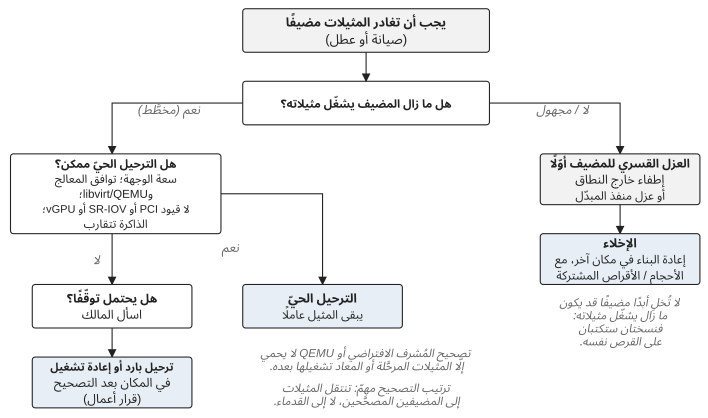

*الجزء السادس — قرارات من الميدان*

# الفصل 20 — الأمن والسعة والأهمية الحرجة للأعمال

المتطلّبات الأمنية حقيقية. لكنّ تنفيذ إجراء أمني قد يُدخل بنفسه خطرًا تشغيليًا، والقرار بشأن *كيفية* تلبية متطلّب ما هو في الغالب قرار أعمال لا يستطيع فريق البنية التحتية أن يتّخذه وحده.

## السياق

منصّة إنتاجية تضمّ ما بين مئة وعدّة مئات من مضيفات الحوسبة، خاضعة لمتطلّب إلزامي بتطبيق تصحيحات نظام التشغيل على تلك المضيفات. يتطلّب تطبيق التصحيحات على مضيف حوسبة عادةً إعادة تشغيله، وإعادة تشغيله من دون تعطيل المثيلات التي يشغّلها تتطلّب نقلها إلى مكان آخر أوّلًا.

## الإشارة

لم تكن لدى المنصّة سعة حوسبة احتياطية كافية لترحيل كلّ حِمل عمل ترحيلًا حيًّا بعيدًا عن كلّ مضيف قبل تطبيق التصحيحات عليه. كان القيد هو السعة اللازمة لتطبيق التصحيح بأمان، لا التصحيح نفسه.

> **ملاحظة تقنية — ما تنطوي عليه صيانة مضيف.** إخراج مضيف حوسبة من الخدمة للصيانة يعني عادةً تعطيل خدمة `nova-compute` فيه حتى لا يضع المجدوِل (scheduler) أيّ مثيلات جديدة عليه، ثمّ نقل المثيلات التي يشغّلها. يُبقي الترحيل الحيّ (live migration) المثيل يعمل أثناء انتقاله؛ ويتطلّب وجهة بما يكفي من المعالج والذاكرة والقرص، وإمّا تخزينًا مشتركًا لأقراص المثيل وإمّا ترحيلًا على مستوى الكتل ينسخها عبر الشبكة، وهو ما يضيف حملًا على الشبكة ونظام التخزين معًا. وله أيضًا قيود توافق تصطدم بها حملة تطبيق التصحيحات مباشرة: يجب أن يكون طراز معالج الوجهة متوافقًا مع طراز معالج المصدر، والترحيل من libvirt/QEMU أحدث إلى أقدم غير مدعوم، ولذلك ما إن تُطبَّق التصحيحات على بعض المضيفات حتى يصبح بإمكان المثيلات الانتقال إليها لا العودة منها، ويصبح ترتيب تطبيق التصحيحات هو ما يقرّر إلى أين يمكن للمثيلات أن تذهب. وبعض المثيلات لا يمكن ترحيلها حيًّا البتّة، أو لا ينبغي ذلك: المثيلات ذات تمرير PCI المباشر أو منافذ SR-IOV المباشرة، والمثيلات التي تستخدم vGPU على الإصدارات التي لا تدعم ترحيل الأجهزة الوسيطة (mediated devices)، وأحمال العمل كثيفة الذاكرة التي تتغيّر صفحاتها أسرع ممّا يمكن نسخها ما لم يُفعَّل auto-converge أو post-copy؛ وفي هذه الحالات تكون إعادة التشغيل ضرورة تقنية لا خيار أعمال. والترحيل البارد (`openstack server migrate`)، الذي يوقف المثيل وينقله، هو الخيار الوسيط. أمّا الإخلاء فعملية مختلفة، مخصّصة لمضيف فشل بالفعل، ويجب ألّا تُستخدم أبدًا على مضيف قد يكون ما زال يشغّل مثيلاته (الفصل 10). وأخيرًا، التصحيح المطبَّق على المُشرف الافتراضي (hypervisor) أو على QEMU لا يحمي إلّا المثيلات التي رُحّلت أو أُعيد تشغيلها بعده؛ فالمثيل الذي يواصل العمل على الملفّ التنفيذي القديم غير مصحَّح. انظر توثيق Nova عن إعداد الترحيل الحيّ واستخدامه، وعن الترحيل البارد، وعن إخلاء المثيلات.

*الشكل 20.1: نقل المثيلات بعيدًا عن مضيف: أيّ عملية تنطبق، وما الذي يجب أن يكون صحيحًا أوّلًا.*

## عدم اليقين

ما كان غير مؤكّد هو أيّ أحمال العمل يمكنها أن تتحمّل إعادة تشغيل بدل ترحيل. ولا يستطيع Nova أن يجيب، لأنّه يرى مثيلات لا عمليات أعمال.

## مخاطر الأعمال

تأخير تطبيق التصحيحات يطيل تعرّض المنصّة للخطر. وإجبار كلّ حِمل عمل على المرور بالترحيل الحيّ لا يمكن إتمامه بالسعة المتاحة. وإعادة تشغيل أحمال العمل من دون معرفة أهمّيتها الحرجة يخاطر بتعطيل عملية أعمال لا يعرف عنها أحد في فريق البنية التحتية.

## الخيارات

ترحيل كلّ شيء، وهو ما لم تسمح به السعة. أو إعادة تشغيل كلّ شيء وقبول أثر مجهول على الأعمال. أو الحصول على المعلومات الناقصة ممّن يملكونها، أي الفرق المستهلكة، وتنفيذ استراتيجية متمايزة.

## القرار

قدّمت الفرق المستهلكة ما لم تستطع البنية التحتية أن تستنتجه: الأهمية الحرجة للأعمال، والتوقّف المقبول، وتوقّعات الاستعادة، والمواعيد النهائية، مجموعةً في جدول مشترك ملأه كلّ فريق لأحمال عمله هو. رُحّلت أحمال العمل الحرجة ترحيلًا حيًّا ضمن السعة المتاحة؛ ونُسّقت إعادة التشغيل لأحمال العمل التي تستطيع تحمّلها. لم يتغيّر الهدف الأمني. أمّا استراتيجية التنفيذ فعكست بيئة التشغيل الفعلية.

## المفاضلة

تستغرق الاستراتيجية المتمايزة وقتًا في التخطيط أطول من الاستراتيجية الموحّدة، وتعتمد على معلومات يجب جمعها من خارج فريق المنصّة. وفي المقابل، تجعل تطبيق التصحيحات قابلًا للتحقيق ضمن السعة الموجودة فعلًا، وتضع القرار بشأن كلّ حِمل عمل في يد من يعرفون ما يفعله.

## النتيجة

طُبّقت التصحيحات على المضيفات من دون إجبار كلّ حِمل عمل على ترحيل لم تكن المنصّة قادرة على استيعابه. وجدول الأهمية الحرجة الذي جُمع للحملة هو من نوع المدخلات التي ينبغي أن تكون موجودة قبل حدث الصيانة بدل أن تُجمع للمرّة الأولى حين يبدأ تطبيق التصحيحات؛ وإذا حُفظ محدَّثًا، سواء بوصفه وثيقة مشتركة أو بيانات وصفية على المثيلات والمشاريع نفسها، يصبح مدخلًا لتخطيط السعة لا عملًا لمرّة واحدة.

## الدرس

العمل الأمني عمل من أعمال المنصّة. يغيّر تطبيق التصحيحات وضع أحمال العمل والسعة والتوافر، ولذلك يجب أن تُدمج المتطلّبات الأمنية مع تخطيط سعة المنصّة بدل أن تُفرض على العمليات من الخارج. وإذا كانت سعة الحوسبة غير كافية لترحيل كلّ حِمل عمل، فذلك قيد على قدرة المؤسّسة على تلبية المتطلّبات الأمنية من دون تعطيل، ولذلك ينبغي أن يشمل تخطيط السعة سيناريوهات الصيانة صراحةً: كم مضيفًا يمكن أن يكون غير متاح في آن واحد، وكم حِمل عمل يمكن أن يكون قيد الانتقال، وكم من السعة الاحتياطية يتطلّب تطبيق التصحيحات بأمان. ويعتمد الجواب على نطاق الفشل: فالمنصّة التي تستطيع تحمّل توقّف مضيف واحد في كلّ رفّ، أو في كلّ منطقة توافر، تحتاج إلى سعة احتياطية بقدر مضيف واحد في كلّ نطاق من تلك النطاقات، لا مضيفًا واحدًا في المجموع.

تحتاج الأهمية الحرجة إلى مدخلات من المستهلكين، وتحتاج إليها قبل حدث الصيانة. المخاطر الأمنية ومخاطر التوافر كلتاهما مخاطر أعمال، وتصويرهما صراعًا بين فريقين تقنيين يُخطئ المقصد: القرار هو إيجاد أكثر توازن آمن يمكن تحقيقه في ضوء الحالة الحقيقية للمنصّة. والصعوبة المتكرّرة في تطبيق التصحيحات على المضيفات، أو ترحيل أحمال العمل، أو ترقية التبعيات، هي أيضًا دليل على شيء أعمق. يبقى على المهمّة الفورية أن تُنجز، لكنّ العملية الأمنية التي تستهلك سعة غير متناسبة في كلّ مرّة هي مشكلة دورة حياة ومكانها خارطة طريق المنصّة. وهنا أيضًا يلتقي الأمن بالمواءمة مع المنبع (upstream): فالمؤسّسة المتخلّفة كثيرًا عن الإصدارات المصانة تواجه في النهاية خيارًا بين عمليات نقل خلفي (backport) محلّية متكرّرة وترقية كبرى، ومع أنّ النقل الخلفي قصير الأجل قد يكون قرارًا عقلانيًا، فإنّ نمطًا طويل الأجل من الانحراف هو دين دورة حياة (الفصلين 14 و17).

> **مبدأ.** تحدّد المتطلّبات الأمنية ما يجب تحقيقه. وتحدّد سعة المنصّة والأهمية الحرجة للأعمال مدى الأمان الذي يمكن تحقيقه به.

---

[الفصل 19 — عندما يكون القرار الآمن هو التوقّف →](19-when-the-safe-decision-is-to-stop.md) · [المحتويات](../README.md) · [← الخاتمة: إبقاء OpenStack تحت التحكّم](21-conclusion-keeping-openstack-under-control.md)

